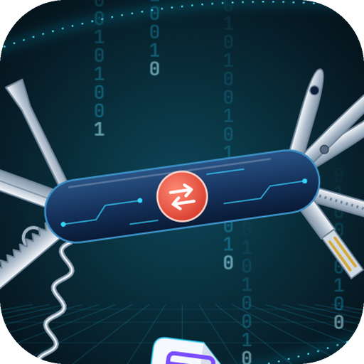
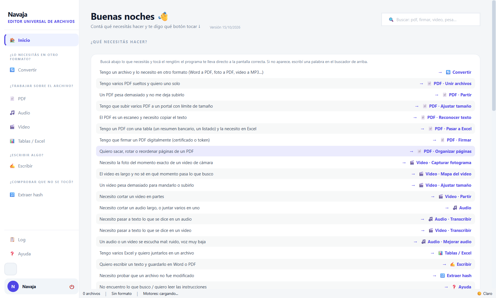
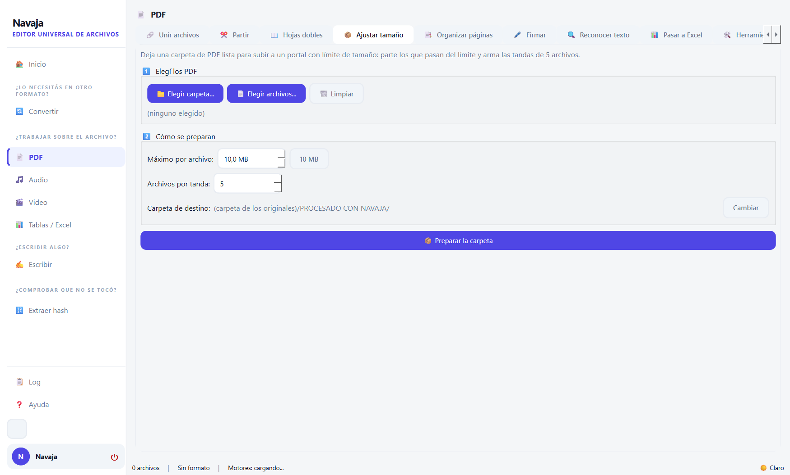

<p align="center">
  
</p>

<h1 align="center">Navaja</h1>
<p align="center"><strong>Editor universal de archivos para Windows: convertir, partir, unir, firmar, transcribir y verificar, todo sin internet.</strong></p>

<p align="center">
  <a href="LICENSE"></a>
  
  
  
</p>

<p align="center">
  
</p>

Navaja junta en un solo programa las herramientas que se usan todos los días con
archivos: pasar un Word a PDF, partir un PDF que pesa demasiado, sacarle el texto a un
escaneo, transcribir un audio, achicar un video para mandarlo por correo o comprobar con
un hash que un archivo no fue modificado.

Está pensado para quien **no sabe de informática**: la pantalla de inicio pregunta
*«¿qué necesitás hacer?»* y lleva directo a la herramienta correcta. Todo funciona
**sin conexión**: ningún archivo sale de la computadora.

> 🇬🇧 **English:** Navaja is an offline, all-in-one file toolkit for Windows (PyQt6).
> It reads 100+ file extensions with automatic multi-step routing, and includes PDF
> tools (merge, split, OCR, digital signing with PFX or USB tokens, PDF→Excel tables),
> audio/video tools (split, merge, compress to a size limit, frame capture, noise
> reduction, Whisper transcription) and SHA-256/SHA-512 integrity checks. The UI is in
> Spanish. Licensed under GPL-3.0.

---

## ✨ Qué hace

| Módulo | Herramientas |
|---|---|
| 🔄 **Convertir** | Lee más de 100 extensiones de archivo (imágenes, audio, video, documentos, datos, correos, e-books, fuentes, subtítulos, comprimidos) y escribe más de 90. Si no hay conversión directa, encuentra sola la cadena más corta: `HEIC → PNG → SVG`. Solo muestra los formatos a los que se puede llegar con lo que hay instalado (audio y video necesitan FFmpeg; Word, Excel y PowerPoint, LibreOffice u Office). |
| 📄 **PDF** | Unir · Partir por tamaño o por páginas · Ajustar una carpeta a un límite de tamaño (en tandas) · Separar hojas escaneadas de a dos · Reordenar, rotar y sacar páginas · **Firma digital PAdES** con certificado `.pfx`/`.p12` o **token USB** (PKCS#11, detecta la marca) · OCR · Pasar a Excel la tabla de un PDF · Comprimir, proteger y reparar |
| 🎵 **Audio** | Cortar · Unir · Mejorar un audio que se oye mal (ruido, voz baja) · **Transcribir** con Whisper, tramo por tramo y con quién habla |
| 🎬 **Video** | Partir sin pérdida · Ajustar a un tamaño máximo · Mapa del video (toda la grabación en una imagen) · Capturar el fotograma exacto · Mejorar el audio · Transcribir |
| 📊 **Tablas / Excel** | Unir varias planillas y partir el resultado |
| ✍️ **Escribir** | Redactar un texto y guardarlo como Word, PDF, ODT, HTML, EPUB, TXT o Markdown |
| 🔢 **Extraer hash** | SHA-256 y SHA-512 de cualquier archivo, y verificación de una huella recibida |

Cada operación deja un **informe técnico** con el hash de los originales y de los
resultados, listo para copiar y pegar. Los originales nunca se modifican.

<p align="center">
  
</p>

## 🚀 Instalación desde el código

Requiere **Python 3.10 o superior** en Windows.

```bash
git clone https://github.com/Gerpi50/navaja.git
cd navaja
python -m venv .venv
.venv\Scripts\activate
pip install -r requirements.txt
python main.py
```

Si falta alguna dependencia básica, el programa la instala sola al arrancar.

### Herramientas externas (opcionales)

Amplían lo que se puede hacer. Navaja las busca primero en una carpeta `bin/` al lado de
`main.py` (o del `.exe`) y después en el `PATH`.

| Herramienta | Qué habilita | Dónde va |
|---|---|---|
| [FFmpeg](https://ffmpeg.org) | Todo lo de audio y video | `bin/ffmpeg.exe`, `bin/ffprobe.exe` |
| [Pandoc](https://pandoc.org) | Markdown, RST, EPUB, LaTeX, ODT | `bin/pandoc.exe` |
| [Tesseract OCR](https://github.com/UB-Mannheim/tesseract/wiki) | Reconocer el texto de un escaneo | `bin/tesseract/` (con `tessdata/`) |
| [LibreOffice](https://www.libreoffice.org) | Word, Excel, PowerPoint, Pages, Keynote | Instalado en el sistema |
| Microsoft Office | Alternativa a LibreOffice para formatos de Office | Instalado en el sistema |

### Transcripción (opcional)

La transcripción usa [Whisper](https://github.com/openai/whisper) y, para reconocer
quién habla, [sherpa-onnx](https://github.com/k2-fsa/sherpa-onnx). Son paquetes
pesados, por eso no vienen en `requirements.txt`:

```bash
pip install openai-whisper sherpa-onnx
pip install torch --index-url https://download.pytorch.org/whl/cpu
```

Los modelos de Whisper (`base.pt`, `medium.pt`…) van en `models/whisper/`. Navaja no los
descarga solo, para respetar el funcionamiento sin internet.

## 📦 Armar el ejecutable

```bash
pip install pyinstaller
pyinstaller navaja.spec
```

Queda en `dist/Navaja/Navaja.exe`. Si existen las carpetas `bin/` y `models/`, se
incluyen en el paquete, y la carpeta entera se puede llevar en un pendrive.

## 🧪 Pruebas

```bash
python tests/test_imports.py
python tests/test_qa.py
python tests/test_compat.py
python tests/test_pdf_md.py
python tests/test_frames.py
python tests/test_gui_start.py
```

## 🗂️ Estructura

```
main.py              ← punto de entrada
core/                ← grafo de conversiones (BFS), rutas, configuración, hashes, informes
motors/              ← un motor por familia de formatos (imágenes, audio, video, PDF, OCR…)
ui/                  ← ventana principal y paneles PyQt6
pdf_excel/           ← preparador visual para pasar tablas de PDF a Excel
transcripcion/       ← Whisper, reproductor y escritor ODT
assets/              ← ícono y logo
tests/               ← pruebas
navaja.spec          ← empaquetado con PyInstaller
```

## 🔌 Agregar un motor de conversión

```python
# motors/mi_motor.py
from core.graph import BaseMotor

class MiMotor(BaseMotor):
    NAME = "MiMotor"
    CONVERSIONS = [("abc", "xyz"), ("xyz", "abc")]

    @classmethod
    def is_available(cls) -> bool:
        import shutil
        return shutil.which("mi-herramienta") is not None

    def convert(self, src_path, dst_path, src_ext, dst_ext, **kwargs):
        ...
```

Después se registra en `main.py` con `graph.register(MiMotor)`. El grafo lo suma a las
rutas posibles y la interfaz muestra los formatos nuevos sin tocar nada más.

## ⚠️ Sin garantía

Navaja se ofrece **tal cual**, sin garantía de ningún tipo, ni siquiera la de que sirva
para un fin determinado. Quien lo usa lo hace bajo su propia responsabilidad: hacé
siempre copia de tus archivos importantes. (Ver las secciones 15 y 16 de la
[licencia](LICENSE).)

## 🙏 Créditos y software de terceros

Navaja no incluye código de otros proyectos: los usa como dependencias que se instalan
aparte, cada una con su propia licencia y sus propios autores.

| Proyecto | Para qué se usa | Licencia |
|---|---|---|
| [PyQt6](https://www.riverbankcomputing.com/software/pyqt/) | Interfaz gráfica | GPL-3.0 |
| [PyMuPDF](https://github.com/pymupdf/PyMuPDF) | Leer, dibujar y editar PDF | AGPL-3.0 |
| [pypdf](https://github.com/py-pdf/pypdf) | Unir y partir PDF | BSD-3-Clause |
| [pdfplumber](https://github.com/jsvine/pdfplumber) | Tablas de PDF a Excel | MIT |
| [pdf2docx](https://github.com/ArtifexSoftware/pdf2docx) | PDF a Word | AGPL-3.0 |
| [pyHanko](https://github.com/MatthiasValvekens/pyHanko) | Firma digital PAdES | MIT |
| [Pillow](https://python-pillow.org) | Imágenes | MIT-CMU |
| [ReportLab](https://www.reportlab.com) | Generar PDF | BSD |
| [pandas](https://pandas.pydata.org) | Datos y planillas | BSD-3-Clause |
| [Whisper](https://github.com/openai/whisper) (opcional) | Transcripción | MIT |
| [sherpa-onnx](https://github.com/k2-fsa/sherpa-onnx) (opcional) | Reconocer quién habla | Apache-2.0 |

Y las herramientas externas, que **no** están en este repositorio y se instalan por
separado: [FFmpeg](https://ffmpeg.org) (LGPL/GPL), [Pandoc](https://pandoc.org) (GPL),
[Tesseract](https://github.com/tesseract-ocr/tesseract) (Apache-2.0) y
[LibreOffice](https://www.libreoffice.org) (MPL-2.0).

La lista completa de dependencias está en [requirements.txt](requirements.txt).

## 📄 Licencia

Copyright © 2026 [Gerpi50](https://github.com/Gerpi50)

Navaja es software libre: se distribuye bajo la licencia **GNU GPL-3.0** (ver
[LICENSE](LICENSE)). Podés usarlo, estudiarlo, modificarlo y compartirlo; si
distribuís una versión modificada, tiene que seguir siendo libre y con su código.

---

<p align="center">🤖 Desarrollado con ayuda de <a href="https://claude.com/claude-code">Claude Code</a>.</p>
